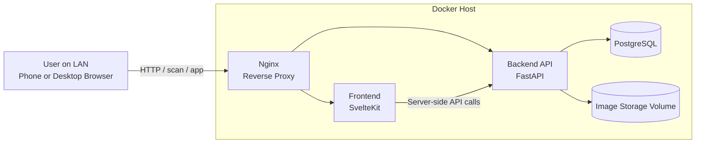

# ContainerScan

ContainerScan is a LAN-only web app for labeling storage containers with QR codes and browsing their contents.

## Architecture



All application traffic stays on the local network. Nginx fronts the app, the frontend talks to the FastAPI backend, and the backend persists container data in Postgres while storing uploaded images on a mounted volume.

## Development Setup

The repository now includes a development compose override with:

- bind mounts for `backend/` and `frontend/`
- backend auto-reload via `uvicorn --reload`
- frontend dev server via `vite`
- direct access to Postgres, backend, frontend, and Nginx

### Prerequisites

- Docker Engine with the Compose plugin

Local lint, test, and build targets also require `uv`, `node`, and `npm`. Run
`make setup` once per checkout to install the project's backend and frontend
dependencies. The backend targets Python 3.14; `uv` provisions it
automatically.

### Start The Dev Stack

Run from the repository root:

```bash
make dev-build
```

Available endpoints:

- App via Nginx: `http://localhost`
- Frontend dev server: `http://localhost:3000`
- Backend API: `http://localhost:8000`
- Postgres: `localhost:5432`

### Stop The Dev Stack

```bash
make dev-down
```

To also remove the database volume:

```bash
make dev-reset
```

## Working in Git Worktrees

The development Compose stack uses a fixed project name (`containerscan`), so
all worktrees share the same containers, network, host ports, and named volumes.

- Only one development stack can run at a time (ports `80`, `3000`, `5432`, and
  `8000` are fixed).
- Run `make dev-*`, `make migrate*`, `make seed-dev`, `make logs`, and `make ps`
  from the worktree that started the stack. The Makefile refuses to operate on
  a stack owned by another worktree; use `FORCE=1` only to take it over or to
  clean up an orphaned stack.
- Stop the stack with `make dev-down` before removing its worktree. `make
  dev-reset` also deletes the shared database, image, and dependency volumes.
- Database schema, seed data, and uploaded images are shared across worktrees.
- The shared frontend `node_modules` volume is only populated when it is first
  created; rebuilding the image does not refresh it. After changing frontend
  dependencies, recreate the volume from the owning worktree:

  ```bash
  make dev-down
  docker volume rm containerscan_frontend_node_modules
  make dev-build
  ```

- A fresh worktree has no local `.venv` or `node_modules`. Run `make setup`
  before using local lint, test, or build targets.
- `.env` is local configuration and is gitignored.

## Server Deployment

Use the repository's own `docker-compose.yml` for deployment. Do not use `docker-compose.dev.yml` on the server.

Copy the sample env file:

```bash
cp .env.example .env
```

Set at least:

- `CONTAINERSCAN_HTTP_PORT`
- `CONTAINERSCAN_PUBLIC_BASE_URL`
- `CONTAINERSCAN_DB_DATA_LOCATION`
- `CONTAINERSCAN_IMAGE_DATA_LOCATION`
- `CONTAINERSCAN_DB_NAME`
- `CONTAINERSCAN_DB_USER`
- `CONTAINERSCAN_DB_PASSWORD`

Create the persistent directories before first start:

```bash
sudo mkdir -p /srv/containerscan/postgres /srv/containerscan/images
sudo chown -R 1000:1000 /srv/containerscan/images
```

Then start the stack:

```bash
docker compose up -d --build
```

Important deployment notes:

- `CONTAINERSCAN_PUBLIC_BASE_URL` must match the durable LAN URL you want printed into QR codes.
- If you change the hostname or port later, old QR labels will still point at the old address.
- The backend runs `alembic upgrade head` automatically during container startup.
- The default sample port is `8088`, which avoids assuming host port `80` is free.

## Database Migrations

Start the stack first so Postgres is available, then run migrations in the backend container:

```bash
make migrate
```

Check the current migration version:

```bash
make migrate-status
```

Seed the development database with sample rooms, labels, and containers:

```bash
make seed-dev
```

Generate a new revision after model changes:

```bash
make migrate-revision MSG="describe change"
```

## Upgrading PostgreSQL

PostgreSQL major versions are not data-compatible. A data directory created by
an older major will not start on a newer one, so upgrading the `postgres` image
requires moving the old data aside and restoring a logical dump into a fresh
directory. These steps require the host-directory layout configured with
`CONTAINERSCAN_DB_DATA_LOCATION` (`/srv/containerscan/postgres` in the examples
above), which is what `.env.example` uses. If you run with the default named
`db_data` volume instead, set `CONTAINERSCAN_DB_DATA_LOCATION` to a host
directory before following them. Plan for downtime; the stack is stopped during
the restore.

1. Take a dump while the old database is still running. Run the steps in the
   same shell session so `DUMP` stays set:

   ```bash
   sudo mkdir -p /srv/containerscan/backups
   sudo chown "$(id -u):$(id -g)" /srv/containerscan/backups
   DUMP=/srv/containerscan/backups/containerscan-16-$(date +%F).dump
   docker compose exec -T db sh -c \
     'pg_dump -U "$POSTGRES_USER" -d "$POSTGRES_DB" -Fc' > "$DUMP"
   ls -lh "$DUMP"
   ```

   The dump redirect runs as your user, so the backup directory must be
   writable by you. Confirm the dump is non-empty before continuing.

2. Stop the stack and move the old data directory out of the way:

   ```bash
   docker compose down
   sudo mv /srv/containerscan/postgres /srv/containerscan/postgres-16
   sudo mkdir -p /srv/containerscan/postgres
   ```

   PostgreSQL 18 and newer store data in a versioned subdirectory
   (`19/docker`), so leave the new directory empty.

3. Set the `db` service in `docker-compose.yml` to the new major
   (`postgres:19-alpine` in this repository), then initialize the new cluster:

   ```bash
   docker compose up -d db
   docker compose ps db
   ```

   For PostgreSQL 18 and newer the data volume must be mounted at
   `/var/lib/postgresql`, not `/var/lib/postgresql/data`. This repository uses
   the new path. Wait until the `db` service reports `healthy`.

4. Restore the dump into the new cluster:

   ```bash
   docker compose exec -T db sh -c \
     'pg_restore -U "$POSTGRES_USER" -d "$POSTGRES_DB" --no-owner --no-privileges' \
     < "$DUMP"
   ```

5. Start the rest of the stack and verify:

   ```bash
   docker compose up -d
   docker compose ps
   docker compose exec backend uv run alembic current
   ```

   The backend runs `alembic upgrade head` on startup, so the restored
   `alembic_version` table should already be at `head`.

6. Keep `/srv/containerscan/postgres-16` until you have confirmed the data is
   intact. To roll back, stop the stack, move `postgres` to `postgres-19`, move
   `postgres-16` back to `postgres`, revert the image tag to
   `postgres:16-alpine` and the mount path to `/var/lib/postgresql/data`, and
   start the stack again.

If you use the default named `db_data` volume, the directory move in step 2 does
not apply; switch `CONTAINERSCAN_DB_DATA_LOCATION` to a host directory before
upgrading, or copy the volume content to a new volume mounted at
`/var/lib/postgresql`. Do not point the new major at the old data directory.

## Updating Dependencies

Show available backend and frontend updates without changing anything:

```bash
make deps-outdated
```

Update dependencies:

```bash
make update-deps
```

This upgrades `backend/uv.lock` to the newest versions allowed by the
constraints in `backend/pyproject.toml`, and updates `frontend/package.json` /
`frontend/package-lock.json` without crossing major versions.

To allow major version bumps for frontend packages:

```bash
make update-deps-major
```

Backend versions remain limited by the ranges in `backend/pyproject.toml`; edit
those ranges manually if a major upgrade is blocked. Major bumps can require
code changes, so review the diff and verify the result:

```bash
make test
make frontend-build
```

If `npm install` fails after `npm-check-updates` has rewritten `package.json`,
there is no automatic rollback. Reset the frontend manifests and retry:

```bash
git checkout -- frontend/package.json frontend/package-lock.json
```

Docker image tags (`postgres`, `nginx`, `python`, `node`) and the pinned `uv`
image in `backend/Dockerfile` are managed manually and are not updated by these
targets. Changing the PostgreSQL major version requires a data migration; see
[Upgrading PostgreSQL](#upgrading-postgresql).

## Useful Local Commands

Install local backend and frontend dependencies:

```bash
make setup
```

Backend lint:

```bash
make backend-lint
```

Backend type/import sanity:

```bash
make backend-compile
```

Frontend production build:

```bash
make frontend-build
```
